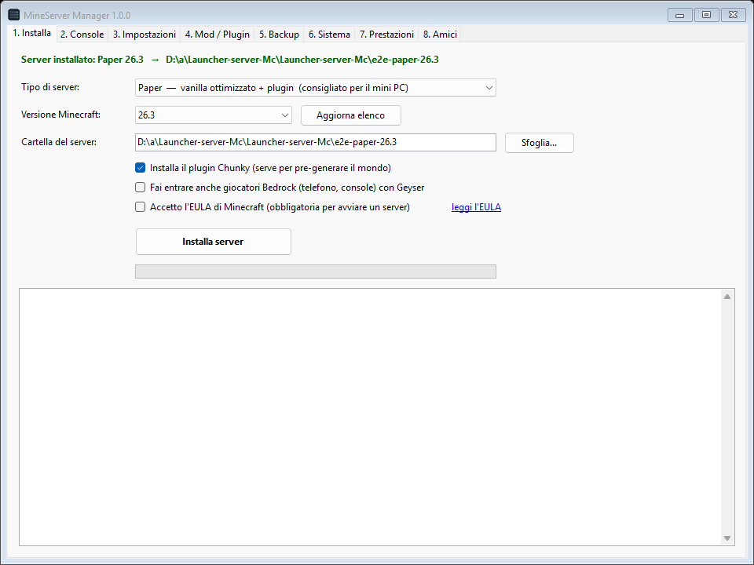
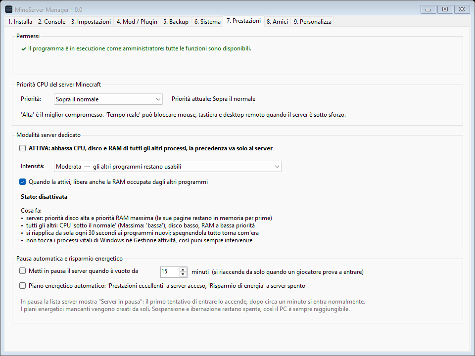
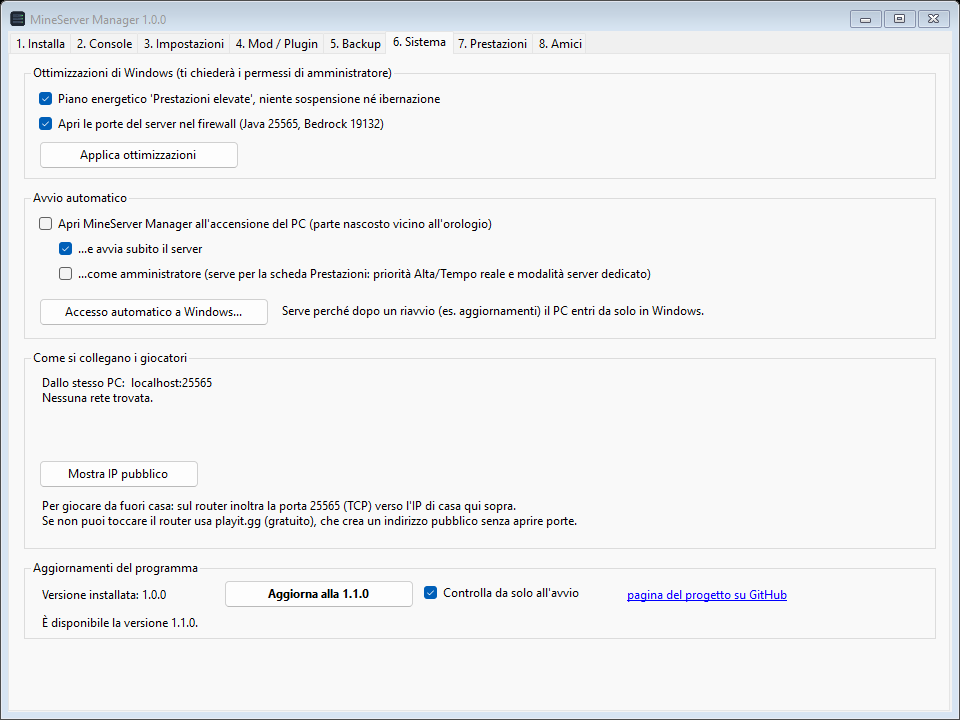

# MineServer Manager

[](https://github.com/P4ty123/Launcher-server-Mc/actions/workflows/build.yml)

Programma per Windows che trasforma un PC, anche poco potente (es. mini PC con Intel N95), in un **server Minecraft** completo e leggero.

## Scarica

👉 **[Ultima versione](https://github.com/P4ty123/Launcher-server-Mc/releases/latest)**: scarica `MineServerManager-Setup.exe` e installalo.
Dopo la prima installazione il programma **si aggiorna da solo** (scheda *Sistema* → *Cerca aggiornamenti*).

## Anteprima

| Console | Installa |
|---|---|
|  |  |
| **Prestazioni** | **Sistema** |
|  |  |

Gli screenshot sono generati automaticamente su Windows (Actions → *Anteprima (screenshot)*).

## Cosa fa

| Scheda | Funzioni |
|---|---|
| 1. Installa | Vanilla, **Paper**, **Fabric** o **Forge**, qualsiasi versione. Scarica da solo la versione di Java giusta. Mod/plugin di ottimizzazione e Geyser (Bedrock) opzionali. |
| 2. Console | Avvia / ferma / riavvia, log in tempo reale, comandi, RAM e CPU, riavvio automatico se crasha, pre-generazione del mondo con Chunky. |
| 3. Impostazioni | RAM del server e `server.properties` con spiegazioni e preset leggero. |
| 4. Mod / Plugin | Ricerca e installazione da Modrinth (solo versioni compatibili, dipendenze incluse). |
| 5. Backup | Backup giornalieri automatici (coerenti anche a server acceso), riavvio programmato, ripristino. |
| 6. Sistema | Prestazioni elevate, niente sospensione, porte del firewall, avvio automatico (anche come amministratore), IP per collegarsi, **aggiornamenti**. |
| 7. Prestazioni | Priorità del server fino a *Tempo reale*; **modalità server dedicato**: abbassa CPU, disco e RAM di tutti gli altri processi. |

## Requisiti

- Windows 10/11 64 bit (testato su Windows 11 LTSC / Atlas OS)
- .NET Framework 4.8 (già incluso in Windows)
- Connessione a Internet per scaricare server, Java e mod

## Test automatici

A ogni modifica GitHub Actions, su un vero PC Windows:

1. compila il programma con lo stesso compilatore usato da `COMPILA.bat`;
2. esegue i **test rapidi** (`MineServerManager.exe --selftest risultati.txt`): elenchi versioni, Modrinth, backup/ripristino, priorità, modalità server dedicato, interfaccia, aggiornamenti;
3. esegue una **prova completa per ogni tipo di server** (`--selftest-e2e Paper risultati.txt`): installazione, avvio fino a `Done`, comandi, backup a server acceso, arresto pulito, errori nel log.

I risultati si vedono nella scheda **Actions** del repository (e si scaricano negli *Artifacts*).

## Pubblicare una nuova versione

1. Vai su **Actions** → **Pubblica una nuova versione** → **Run workflow**.
2. Scrivi il numero di versione (es. `1.0.1`, più alto del precedente) e, se vuoi, le novità.
3. GitHub compila, esegue i test, crea l'installer e pubblica la release. I programmi già installati la troveranno con *Cerca aggiornamenti*.

## Compilare a mano

Doppio clic su `COMPILA.bat` (usa il compilatore C# già presente in Windows, non serve installare nulla).

## Struttura

```
src/                 codice sorgente (C# / WinForms, .NET Framework 4.8)
installer/setup.iss  installer (Inno Setup)
.github/workflows/   build + test su Windows, pubblicazione delle release
COMPILA.bat          compilazione locale
```
