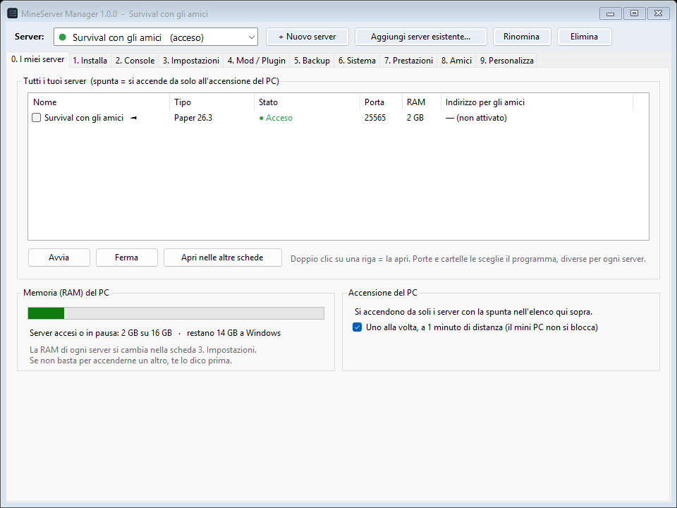
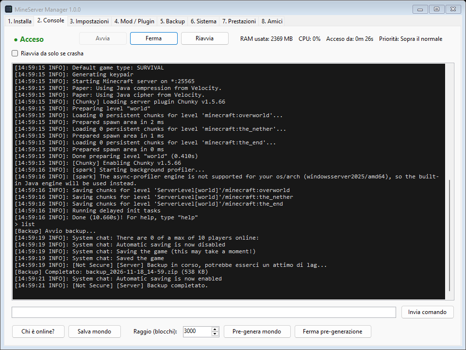
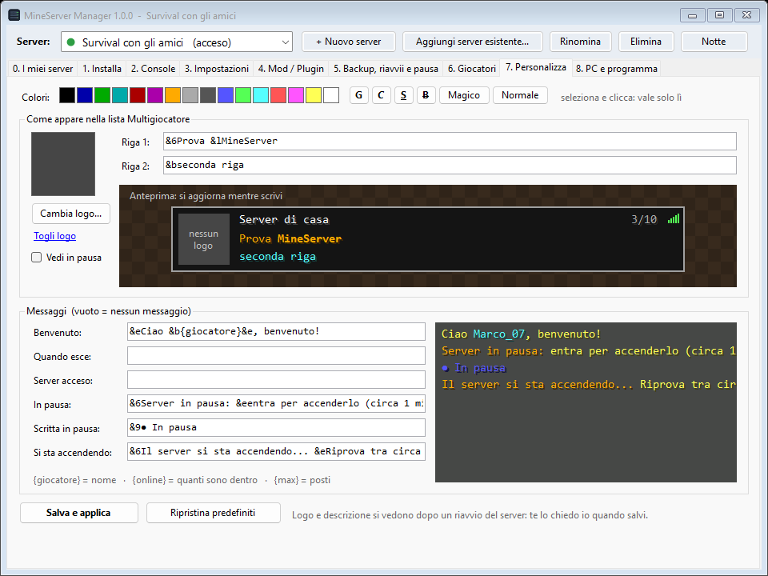
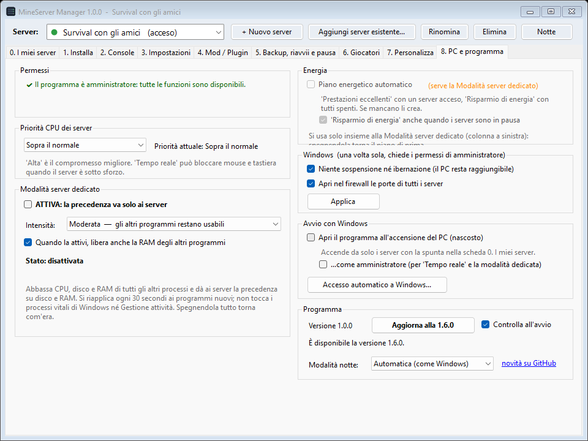
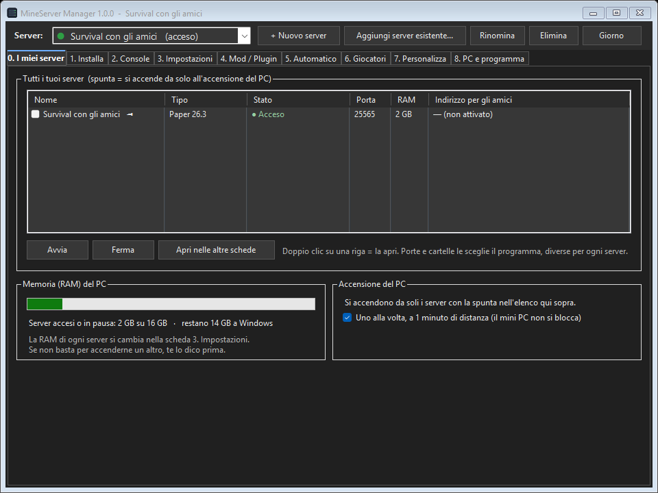
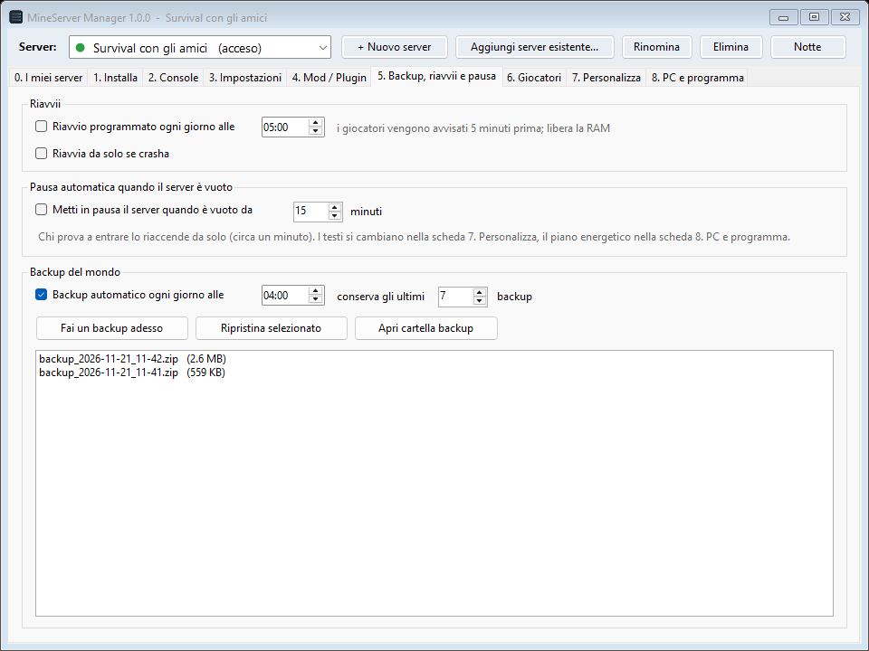

# MineServer Manager

[](https://github.com/P4ty123/Launcher-server-Mc/actions/workflows/build.yml)

Programma per Windows che trasforma un PC, anche poco potente (es. mini PC con Intel N95), in un **server Minecraft** completo e leggero.

## Scarica

👉 **[Ultima versione](https://github.com/P4ty123/Launcher-server-Mc/releases/latest)**: scarica `MineServerManager-Setup.exe` e installalo.
Dopo la prima installazione il programma **si aggiorna da solo** (scheda *8. PC e programma* → *Cerca aggiornamenti*).

## Anteprima

| I miei server | Console |
|---|---|
|  |  |
| **Personalizza** | **PC e programma** |
|  |  |
| **Modalità notte** | **Backup, riavvii e pausa** |
|  |  |

Gli screenshot sono generati automaticamente su Windows (Actions → *Anteprima (screenshot)*).

## Cosa fa

| Scheda | Funzioni |
|---|---|
| 0. I miei server | **Più server** (anche accesi insieme): elenco con stato, porta, RAM e indirizzo playit di ognuno, Avvia/Ferma, scelta di quali accendere all'avvio del PC (uno alla volta), controllo della RAM. Menu in alto per passare da un server all'altro: ogni server ha mod, backup, impostazioni e personalizzazione sue. Nuovo / Aggiungi server esistente / Rinomina / Elimina. |
| 1. Installa | Vanilla, **Paper**, **Fabric**, **Forge** o **NeoForge**, qualsiasi versione. Scarica da solo la versione di Java giusta. Mod/plugin di ottimizzazione e Geyser (Bedrock) opzionali. **Importa modpack** da Modrinth (anche cercandolo dal programma) o da CurseForge (Server Pack, cartella dell'app, zip esportato). |
| 2. Console | Avvia / ferma / riavvia, log in tempo reale, comandi, RAM e CPU, pre-generazione del mondo con Chunky, **Trova cosa fa lag** (spark). |
| 3. Impostazioni | RAM del server, **argomenti di avvio** di Java (come su exaroton, es. `-Xms6G -Xmx6G`), le impostazioni principali di `server.properties` con spiegazioni (le altre con "Mostra anche quelle tecniche"), **Ottimizza automaticamente** (profili Leggero / Bilanciato / Qualità / Modpack pesante, anche per i file di Paper) con ripristino degli originali. |
| 4. Mod / Plugin | Ricerca e installazione da Modrinth (solo versioni compatibili, dipendenze incluse). **Controlla mod solo client**: trova e mette da parte le mod che servono solo al gioco (anche messe a mano), con ripristino. |
| 5. Backup, riavvii e pausa | Tutto ciò che il server fa da solo: backup giornalieri (coerenti anche a server acceso) e ripristino, riavvio programmato, riavvio se crasha, **pausa automatica** quando il server è vuoto (si riaccende quando qualcuno prova a entrare, anche da Bedrock). |
| 6. Giocatori | Indirizzo **playit.gg** per giocare da fuori casa (senza toccare il router), con scelta della **regione** per chi ha playit Premium (es. Europa/Germania); **porte di ogni server** per chi è in casa, con spiegazione di ipconfig; **whitelist** di ogni server, copiabile su tutti i server. |
| 7. Personalizza | **Logo** e **descrizione colorata** nella lista Multigiocatore con anteprima, **messaggi** colorati (benvenuto, uscita, server acceso, pausa). |
| 8. PC e programma | Vale per tutti i server: **piano energetico automatico** (*Prestazioni eccellenti* / *Risparmio di energia*), niente sospensione, firewall, avvio con Windows (anche come amministratore), priorità fino a *Tempo reale*, **modalità server dedicato**, aggiornamenti, **modalità notte**. |

## Requisiti

- Windows 10/11 64 bit (testato su Windows 11 LTSC / Atlas OS)
- .NET Framework 4.8 (già incluso in Windows)
- Connessione a Internet per scaricare server, Java e mod

## Test automatici

A ogni modifica GitHub Actions, su un vero PC Windows:

1. compila il programma con lo stesso compilatore usato da `COMPILA.bat`;
2. esegue i **test rapidi** (`MineServerManager.exe --selftest risultati.txt`): elenchi versioni, Modrinth, backup/ripristino, priorità, modalità server dedicato, interfaccia, aggiornamenti;
3. esegue una **prova completa per ogni tipo di server** (`--selftest-e2e Paper risultati.txt`): installazione, avvio fino a `Done`, comandi, backup a server acceso, arresto pulito, errori nel log.

I risultati si vedono nella scheda **Actions** del repository (e si scaricano negli *Artifacts*).

## Pubblicare una nuova versione

1. Vai su **Actions** → **Pubblica una nuova versione** → **Run workflow**.
2. Scrivi il numero di versione (es. `1.0.1`, più alto del precedente) e, se vuoi, le novità.
3. GitHub compila, esegue i test, crea l'installer e pubblica la release. I programmi già installati la troveranno con *Cerca aggiornamenti*.

## Compilare a mano

Doppio clic su `COMPILA.bat` (usa il compilatore C# già presente in Windows, non serve installare nulla).

## Struttura

```
src/                 codice sorgente (C# / WinForms, .NET Framework 4.8)
installer/setup.iss  installer (Inno Setup)
.github/workflows/   build + test su Windows, pubblicazione delle release
COMPILA.bat          compilazione locale
```
